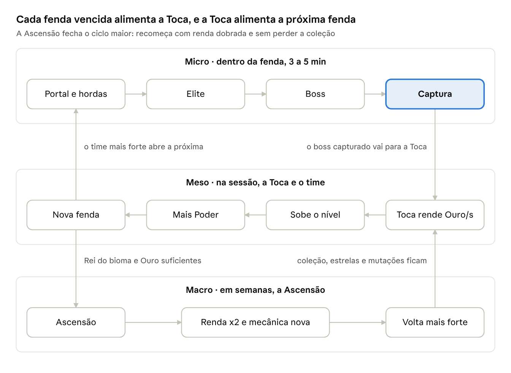
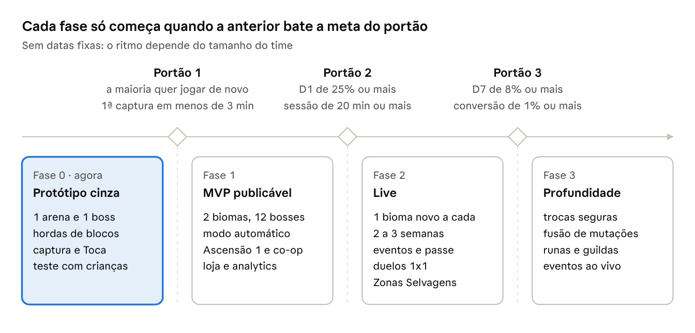

# Rift Tamers — Game Design Document

Nov 23, 2026 · @Samuel

Rift Tamers é um jogo de Roblox de dungeon de hordas em que todo boss derrotado pode ser capturado e vira renda por segundo na sua base. Este documento fixa o design do MVP. Rift Tamers é um nome provisório.

## Visão e pilares

**Entre na fenda, limpe as hordas, derrote o boss — e ele passa a ser seu.** O jogo junta duas fórmulas que já provaram funcionar no Roblox: coleção com renda por segundo (Steal a Brainrot, Steal an Egg) e dungeon de hordas por portal (Chaos Dungeon, de Lost Ark).

- **Público:** de 8 a 16 anos, celular primeiro.
- **Visual:** fantasia low-poly colorida, num meio-termo entre fofo e épico, sem ser sombrio.
- **Combate:** híbrido. Você move o avatar, o monstro ataca sozinho e você usa as habilidades. Fendas dominadas liberam o modo automático.
- **PvP:** opcional, só em duelos 1x1 e nas Zonas Selvagens. Ninguém perde monstros.
- **Base teórica:** *A Theory of Fun for Game Design*, de Raph Koster. Todo sistema precisa ensinar um padrão novo.

Os quatro pilares:

1. **Captura como pico de emoção.** Todo boss pode virar seu. O Cristal de Selo tremendo é o momento mais forte do jogo.
2. **Números sempre subindo.** A renda por segundo está sempre visível e cresce de forma exponencial.
3. **Um padrão novo em cada fenda.** O que você já dominou passa para o modo automático; sua atenção vai para o próximo desafio.
4. **Exibir a coleção.** Tocas visíveis na praça, anúncios globais e ranking.

## Por que os jogos de referência funcionam

Os sucessos do gênero repetem a mesma fórmula. O jogador entra em 30 segundos sem conseguir falhar. A renda sobe na tela o tempo todo. A coleção tem raridades e mutações, a vitória é exibida para os outros, e existe um reset com multiplicador. Updates chegam toda semana.

| Jogo | O que prende | Lição para Rift Tamers |
| --- | --- | --- |
| [Steal an Egg](https://www.rolimons.com/game/107778070777162) | Roubar o ovo no ninho e voltar carregando, pesado e perseguido. O pet chocado rende por segundo. A velocidade libera biomas. Servidores de 7 jogadores, cerca de 18 min por sessão e pico de 14,3 milhões de jogadores simultâneos (19/09/2026). | Um risco curto antes da recompensa cria tensão e alívio. A progressão por chave de acesso deixa claro o próximo objetivo. |
| [Steal a Brainrot](https://www.pcgamer.com/games/sim/one-of-robloxs-biggest-experiences-right-now-is-a-bizarre-italian-brainrot-character-stealing-simulator-and-lord-help-me-i-now-understand-why-its-so-popular) | Bases visíveis numa praça de 8 jogadores. Toda compra é anunciada a todos. A renda vai de $1/s a milhões por segundo, e o rebirth libera ferramentas novas. | Progresso visível e social. Números exponenciais. |
| [Fish It](https://rowatcher.com/news/fish-it-reels-in-270k-players-inside-roblox-s-most-addictive-casual-game-of-2026) | Nenhum fracasso: sempre pega algo. Raridade exibida como "1 em X". A pesca automática leva a sessões de cerca de 77 min. | O modo automático alonga a sessão, e o algoritmo do Roblox recomenda jogos com sessões longas. |
| [Grow a Garden](https://rowatcher.com/news/the-simulation-takeover-why-casual-sims-rule-roblox-in-2026) | Mutações acumuláveis (até 150x) e economia de trocas. Chegou a 22,3 milhões de jogadores simultâneos, mas caiu 99% depois de um exploit de duplicação nas trocas. | Economia 100% no servidor. Trocas só com sistema seguro. |
| [Fisch](https://rowatcher.com/news/the-simulation-takeover-why-casual-sims-rule-roblox-in-2026) | Criou o gênero de pesca, mas perdeu jogadores para o Fish It depois de monetização agressiva. | Pagar acelera, nunca bloqueia. |
| [Bee Swarm Simulator](https://rowatcher.com/news/the-simulation-takeover-why-casual-sims-rule-roblox-in-2026) | 8 anos no ar com profundidade de sinergias e confiança no desenvolvedor. | A longevidade vem de sistemas profundos, não só de conteúdo novo. |

Os números de jogadores vêm de sites de fãs e de métricas, que às vezes discordam entre si. Use-os como ordem de grandeza.

## Theory of Fun: as regras do design

**A dopamina segura a sessão; o aprendizado segura o mês.** Para Koster, diversão é aprender: o cérebro gosta de reconhecer e dominar padrões. O tédio chega quando o padrão já foi dominado, ou quando há tanto ruído que nenhum padrão aparece. O loot é feedback, não a diversão em si: recompensa sem nada novo a aprender cansa rápido.

| Princípio de Koster | Regra no Rift Tamers |
| --- | --- |
| Diversão é aprender padrões novos | Cada fenda ensina um padrão novo: um inimigo, um ataque de boss ou uma interação de elemento. Nunca é só mais vida. |
| O padrão dominado vira rotina (*chunking*) | O modo automático assume a fenda dominada e libera a atenção para o próximo padrão. |
| Jogadores otimizam até tirar a diversão do jogo | O caminho mais eficiente precisa ser o divertido. Uma fenda em que seu Poder é 3x o recomendado rende 50% do loot. |
| Recompensa proporcional ao desafio | O loot sobe com a dificuldade (Normal, Difícil, Pesadelo). |
| Preparação antes do desafio | Montar o time de 3 monstros e decidir quem luta e quem fica na Toca gerando renda. |
| Senso de espaço | Arenas com formatos diferentes (corredor, círculo, plataformas), cada uma pedindo uma tática de área. |
| Mecânica central sólida | Mover, agrupar a horda e soltar a habilidade de área na hora certa. |
| Variedade de desafios | Hordas, elites, eventos surpresa e boss com fases. |
| Variedade de habilidades | Posicionamento, timing de habilidade, leitura do aviso do boss e timing de captura. |
| Habilidade no uso das habilidades | O timing perfeito na captura aumenta a chance. É sorte e habilidade juntas. |
| A falha custa, mas pouco | Ao perder, você fica com 50% dos fragmentos e tenta de novo em 5 segundos. Nunca perde monstros. |
| Pessoas diferentes, jogos diferentes | Camada rasa para quem tem 8 anos (cores, números, captura). Camada funda para quem tem 15 (sinergias, elementos, mutações). |
| Emoções além da diversão | *Fiero* ao derrotar o boss. *Kvell* (orgulho) ao evoluir o seu monstro. *Schadenfreude* nos duelos. Encanto com mutações bonitas. Status com o anúncio global. |
| A responsabilidade de quem faz jogos | Limites claros de monetização, descritos na seção de monetização. |

**Teste obrigatório para todo conteúdo novo.** Se uma resposta for "nada", o conteúdo é cortado ou redesenhado.

1. Que padrão novo isto ensina?
2. Que decisão de preparação isto cria?
3. Para onde o jogador vai depois de dominar isto?

## Os três loops

**Três ciclos encaixados, cada um alimentando o maior:** a fenda leva minutos, a Toca dura uma sessão e a Ascensão leva semanas.



A fenda entrega o boss capturado à Toca. A Toca rende Ouro, o Ouro fortalece o time e o time abre fendas novas. Quando o jogador vence o Rei do bioma, a Ascensão reinicia o ciclo com renda maior.

## A fenda, estágio por estágio

**Uma fenda dura de 3 a 5 minutos e termina sempre num pico: a captura.** É a adaptação do Chaos Dungeon: cada abate enche uma barra, e a barra cheia abre o portal para o estágio seguinte. Ela acontece no mesmo servidor, sem tela de carregamento.

| Estágio | O que acontece | Pico de emoção | O que o jogador aprende |
| --- | --- | --- | --- |
| 1. Hordas (cerca de 60 s) | Ondas de 10 a 20 inimigos fracos. Cada abate enche a barra da fenda. Os fragmentos caem e vêm até você como ímã. | Abates em massa, números saltando, moedas | Agrupar a horda e usar a habilidade de área |
| 2. Hordas e elite (cerca de 90 s) | Ondas maiores e 1 elite com uma mecânica nova (escudo, invocação ou investida). Em 10% das partidas aparece o Bolsinho Dourado, que foge com moedas e precisa ser perseguido. | Surpresa de recompensa variável | Achar a ameaça prioritária |
| 3. Boss (60 a 120 s) | Arena própria. 2 a 3 ataques avisados por marcações no chão. Abaixo de 50% de vida, a fase 2 acelera os ataques. | Tensão que vira *fiero* | Ler e esquivar padrões |
| Captura (cerca de 8 s) | Com 15% de vida, o boss fica atordoado. Aparece o Cristal de Selo com um anel de timing: Bom ou Perfeito. O cristal treme 1, 2, 3 vezes e então captura ou quebra. | O pico de dopamina do jogo | Timing |
| Baú (cerca de 5 s) | Contador subindo, raio na cor da raridade e som que cresce. | Recompensa variável | — |

Regras da partida:

- **Derrota:** você fica com 50% dos fragmentos e pode tentar de novo em 5 segundos.
- **Captura que falhou:** o boss foge, mas você ganha Marcas de Caça, que aumentam a chance na próxima vez.
- **Dificuldades:** Normal, Difícil e Pesadelo. Cada nível acima dá 1,5x de loot, e o Pesadelo libera a variante Ancestral (Divina) do boss.
- **Grupo:** até 4 jogadores. A vida dos inimigos sobe 70% por jogador extra, e cada jogador tem a sua própria tentativa de captura.

## Captura e variações

**Um mesmo boss pode sair em centenas de versões: raridade, tamanho, mutação e estrelas se multiplicam.** É assim que se cria uma coleção enorme com poucos modelos 3D. Toda chance aparece na tela antes da tentativa, no formato "1 em X" e em porcentagem.

**Chance de captura** (limite de 95%; o Cristal Supremo garante 100%):

```latex
Chance = \min\left(95\%,\; B_{raridade} \cdot C_{cristal} \cdot (1 + T_{timing}) \cdot (1 + S_{sorte}) + 5\,p.p. \cdot Marcas\right)
```

- **Cristal:** Comum x1, Grande x1,5, Mestre x2, Supremo garante a captura.
- **Timing:** Bom +10%, Perfeito +25%. O modo automático sempre tira Bom.
- **Marcas de Caça:** +5 pontos percentuais por falha na mesma espécie. Zeram na captura.
- **Primeira captura do jogo:** garantida, como parte do tutorial.

### Raridade

Cada espécie de boss tem uma raridade fixa. Os valores de renda são do bioma 1; cada bioma seguinte multiplica por 10.

| Raridade | Onde aparece | Frequência | Renda base (Ouro/s) | Chance base de captura |
| --- | --- | --- | --- | --- |
| Comum | Boss da Fenda 1 | Sempre | 5 | 90% |
| Incomum | Boss da Fenda 2 | Sempre | 12 | 80% |
| Raro | Boss da Fenda 3 | Sempre | 30 | 65% |
| Épico | Bosses das Fendas 4 e 5 | Sempre | 80 | 50% |
| Lendário | Rei do bioma | Sempre | 250 | 35% |
| Mítico | Variante Alfa, que substitui o boss de qualquer fenda | 1 em 50 partidas | 1.000 | 20% |
| Divino | Variante Ancestral, só no Pesadelo | 1 em 500 partidas | 5.000 | 10% |
| Secreto | Boss escondido, liberado por uma condição secreta (ex.: vencer o Pesadelo sem tomar dano) | 1 em 10, depois da condição | 25.000 | 5% |

O Secreto junta sorte e aprendizado: primeiro é preciso descobrir e cumprir a condição, e a comunidade vai trocar dicas sobre isso.

### Tamanho

| Tamanho | Multiplicador de renda | Chance |
| --- | --- | --- |
| Mini | x0,8 | 20% |
| Normal | x1 | 60% |
| Grande | x1,5 | 14% |
| Gigante | x2 | 5% |
| Titânico | x3 | 1% |

### Mutação

No jogo, a mutação é só troca de material e uma aura de partículas: não exige modelo novo.

| Mutação | Multiplicador de renda | Chance | Visual |
| --- | --- | --- | --- |
| Nenhuma | x1 | 92,38% | Cores originais |
| Dourado | x2 | 5% (1 em 20) | Ouro polido e brilho suave |
| Cristal | x3 | 2% (1 em 50) | Corpo translúcido e reflexos |
| Arco-íris | x5 | 0,5% (1 em 200) | Cores em ciclo e rastro colorido |
| Eclipse | x8 | 0,1% (1 em 1.000) | Roxo profundo com uma lua orbitando |
| Cósmico | x12 | 0,02% (1 em 5.000) | Textura de galáxia e estrelas cintilando |

Mutações de evento ficam fora da tabela fixa: Abóbora (outubro), Neve (dezembro) e Selvagem (x4, só nas Zonas Selvagens). Quando uma poção ou passe de sorte está ativo, a tabela mostrada ao jogador é atualizada com as chances reais, como exige a política do Roblox.

### Estrelas

Capturar a mesma espécie de novo permite fundir as cópias e subir de estrela. Cada estrela dá +10% de renda e +20% de Poder. Na 3ª e na 5ª estrela o monstro muda de visual (chifres, aura). As estrelas custam 1, 2, 4 e 8 cópias, num total de 15 cópias até 5 estrelas.

### Elementos

Fogo vence Natureza, Natureza vence Água e Água vence Fogo. Luz e Sombra vencem uma à outra. Quem tem vantagem causa +50% de dano e recebe −25%. O ícone de fraqueza aparece sobre cada inimigo, então até quem tem 8 anos entende.

## Bestiário do MVP

**O MVP tem 12 bosses capturáveis em 2 biomas, e cada um ensina um padrão que o anterior não ensinava.** O Rei de cada bioma é a prova final: mistura os padrões dos cinco bosses anteriores. Os nomes são provisórios e 100% originais.

| Bioma | Fenda | Boss | Elemento | Raridade | Padrão que ensina | Papel |
| --- | --- | --- | --- | --- | --- | --- |
| Bosque Musgoso | 1 | Musguinho, um toco de árvore que rola | Natureza | Comum | Investida em linha reta com marca no chão: esquivar para o lado | Tesoureiro |
| Bosque Musgoso | 2 | Sapo-Lanterna | Água | Incomum | Salto que cai numa área circular: sair do círculo | Lutador |
| Bosque Musgoso | 3 | Cogumestre | Natureza | Raro | Invoca cogumelos-mina: destruir os ajudantes primeiro | Tesoureiro |
| Bosque Musgoso | 4 | Javali Raiz | Natureza | Épico | Escudo de casca na frente: atacar pelos lados e pelas costas | Lutador |
| Bosque Musgoso | 5 | Coruja Bruma | Água | Épico | Some na neblina e se revela por um brilho: ler sinais | Lutador |
| Bosque Musgoso | Rei | Ancião Carvalhorn, cervo-árvore gigante | Natureza | Lendário | Ondas de raízes e ajudantes, juntando tudo o que o bioma ensinou | Os dois |
| Dunas de Cristal | 1 | Escarabrilho | Luz | Comum | Reflete o dano quando brilha: parar de atacar na hora certa | Tesoureiro |
| Dunas de Cristal | 2 | Lagartixa Brasa | Fogo | Incomum | Deixa um rastro de fogo no chão: controlar o espaço | Lutador |
| Dunas de Cristal | 3 | Cacto Tambor | Natureza | Raro | Anel de espinhos com uma brecha: achar a brecha | Tesoureiro |
| Dunas de Cristal | 4 | Escorpião Prisma | Luz | Épico | Divide-se em 3 cópias e só uma é real: achar a verdadeira | Lutador |
| Dunas de Cristal | 5 | Djinn de Areia | Fogo | Épico | Tempestade que empurra, com pilares de cristal como abrigo: usar o cenário | Lutador |
| Dunas de Cristal | Rei | Esfinge Solarya | Luz | Lendário | Símbolos no chão: pisar na sequência certa para quebrar o escudo | Os dois |

**Lutador** tem mais Poder; **tesoureiro** tem mais renda por segundo. Isso cria a escolha de preparação entre levar o monstro para a fenda ou deixá-lo rendendo na Toca.

As variantes Mítico (Alfa), Divino (Ancestral) e Secreto usam o mesmo modelo, com outra paleta, mais tamanho e uma aura. O Secreto ainda ganha um ataque extra.

**Inimigos comuns (12 tipos):**

- Bosque Musgoso: Brotinho, Vagalume-Faísca, Lesma de Musgo, Lobo de Folhas. Elites: Ent Guardião e Xamã Cogumelo.
- Dunas de Cristal: Areinha, Cristalino (explode ao morrer), Escorpinho, Abutre Prisma. Elites: Golem de Vidro e Mago das Dunas.
- Evento surpresa: Bolsinho Dourado, um saquinho de moedas com pernas que foge pela arena.

## Toca e economia

**O Ouro é o motor do jogo: a Toca gera Ouro por segundo, o Ouro deixa o time mais forte, e o time mais forte captura bosses que geram ainda mais Ouro.** São só três moedas, para uma criança entender tudo em poucos minutos.

| Moeda | Como se ganha | Onde se gasta |
| --- | --- | --- |
| Ouro | Renda da Toca, drops das fendas e libertar monstros | Nível dos monstros (Poder), vagas e melhorias da Toca e Cristais Grandes |
| Fragmentos de Fenda | Fendas, com mais no Difícil e no Pesadelo | Forja: Cristal Mestre, poções de sorte de 5 min e cosméticos do bioma |
| Gemas (premium) | Robux. Também vem de missões diárias, Monstrodex e passe gratuito (meta de 30 a 50 por dia jogando) | Cristal Supremo, poções de 15 min, Baús de Fenda, cosméticos e acelerar fusão |

**Renda de um monstro na Toca:**

```latex
Renda/s = B_{raridade} \cdot 10^{(bioma-1)} \cdot T \cdot M \cdot (1 + 0{,}1(E-1)) \cdot (1 + 0{,}1N_{fonte}) \cdot A \cdot P
```

Na fórmula, *T* é o tamanho, *M* a mutação, *E* as estrelas (de 1 a 5), *N* os níveis da Fonte Mágica, *A* o multiplicador de Ascensão e *P* os passes.

Regras da Toca:

- **Vagas:** começa com 4. O Ouro libera até 12 vagas: a 5ª custa 500 Ouro e cada uma seguinte custa 3x a anterior, então a 12ª sai por cerca de 1,1 milhão. O passe dá +4 vagas.
- **Time na fenda:** monstros no time rendem 25% enquanto lutam. Assim, levar o melhor para a luta não zera a renda, mas custa.
- **Fonte Mágica:** +10% de renda para todos por nível, até o nível 10. O primeiro custa 1.000 Ouro e cada nível seguinte custa 4x o anterior.
- **Cofre:** o Ouro se acumula num cofre que você toca para coletar, com chuva de moedas. Ele guarda 2 horas de renda, inclusive offline (8 horas com o passe).
- **Nível de monstro:** custa Ouro. O nível 2 custa 200 e cada nível seguinte custa 25% a mais. Cada nível dá +8% de Poder, até o nível 100.
- **Libertar:** soltar um monstro repetido rende o Ouro de 10 minutos da renda dele.
- **Pedestal:** o melhor monstro fica exposto na frente da Toca, com uma placa da sua renda total.

Os números são um ponto de partida. A curva completa, com renda por hora de jogo, fica na planilha de balanceamento.

## Mundo e progressão

**Sete biomas, cada um com 10x a renda do anterior e um padrão de combate que só existe ali.** O Poder do time é a chave de acesso, como a velocidade no Steal an Egg: o próximo objetivo fica sempre claro.

| Bioma | Visual | Elementos | Poder para entrar | Renda de um Épico (Ouro/s) | Padrão novo | Fase |
| --- | --- | --- | --- | --- | --- | --- |
| 1. Bosque Musgoso | Floresta verde com cogumelos que brilham | Natureza, Água | 0 | 80 | Esquiva e ataque em área | MVP |
| 2. Dunas de Cristal | Areia dourada e cristais rosados | Fogo, Luz | 500 | 800 | Sinais e enganos (reflexo, cópias) | MVP |
| 3. Pântano de Cogumelos | Pântano lilás com neblina | Água, Sombra | 5 mil | 8 mil | Veneno que acumula e como limpar | Live |
| 4. Pico Gelado | Neve azul e auroras | Água, Luz | 50 mil | 80 mil | Chão escorregadio e congelamento | Live |
| 5. Forja Vulcânica | Lava laranja e rochas escuras | Fogo, Sombra | 500 mil | 800 mil | Plataformas que caem | Live |
| 6. Ilhas do Céu | Nuvens e ruínas flutuantes | Luz, Natureza | 5 milhões | 8 milhões | Vento e risco de queda | Live |
| 7. Abismo Estelar | Espaço violeta com constelações | Sombra, Luz | 50 milhões | 80 milhões | Gravidade e portais | Live |

Regras de progressão:

- **Poder do time:** a soma do Poder dos 3 monstros do time.
- **Dentro do bioma:** a fenda 2 abre quando a fenda 1 é vencida no Normal, e assim por diante. O Rei abre depois da fenda 5.
- **Ritmo:** o próximo desbloqueio leva cerca de 2 minutos no começo e de 30 a 60 minutos nos biomas finais.
- **Visual:** a Sombra é roxa e misteriosa, nunca assustadora, para manter a classificação de conteúdo leve.

## Ascensão

**A Ascensão zera o progresso, dobra a renda para sempre e libera uma mecânica nova; a coleção nunca é apagada.** A primeira deve acontecer depois de 3 a 5 horas de jogo. Pela regra de Koster, o reset precisa ensinar algo, não só multiplicar números.

- **Zera:** Ouro, vagas e melhorias da Toca, nível dos monstros e fendas liberadas.
- **Mantém:** todos os monstros, estrelas, mutações, Monstrodex, Gemas e cosméticos.

| Nível | Requisito | Renda | Bônus | Mecânica nova |
| --- | --- | --- | --- | --- |
| A1 | Rei das Dunas + 10 milhões de Ouro | x2 | +5% de sorte, +1 vaga | Combos de elemento: dois monstros do mesmo elemento liberam uma habilidade especial |
| A2 | Rei do Pântano + 200 milhões | x4 | +10% de sorte, +1 vaga | Fendas de Elite e Zonas Selvagens (PvP opcional) |
| A3 | Rei do Pico + 5 bilhões | x8 | +15% de sorte | Fusão de mutações: dois monstros mutados dão chance de uma mutação superior |
| A4 | Rei da Forja + 100 bilhões | x16 | +20% de sorte, +1 vaga | Runas: equipamentos que mudam como o monstro luta |
| A5 | Rei das Ilhas + 2 trilhões | x32 | +25% de sorte | Fenda Infinita: andares sem fim com ranking semanal |

Depois de ascender, o jogador refaz os biomas iniciais muito mais rápido. Isso é a sensação de domínio, e a mecânica nova chega a tempo de evitar o tédio.

O Ouro pedido em cada nível sai da planilha de balanceamento: é a renda estimada dos 12 melhores monstros no Rei exigido vezes 30 minutos de jogo. Pela planilha, a primeira Ascensão acontece com cerca de 4 horas de jogo.

## Combate

**Você controla o posicionamento e o timing; o monstro cuida do ataque básico.** Assim o combate funciona com um dedo no celular, mas ainda premia quem joga bem.

- **Controles:** analógico, 1 botão de esquiva (recarga de 3 s) e 3 botões de habilidade, um por monstro do time.
- **Monstro principal:** segue o avatar e ataca sozinho o inimigo mais próximo.
- **Os outros dois:** não aparecem em campo. Cada um empresta uma habilidade, e o Poder dos três soma no Poder do time.
- **Recarga:** as habilidades recarregam em 6 a 12 segundos.

| Elemento | Habilidade | Efeito |
| --- | --- | --- |
| Fogo | Explosão | Dano alto em área à frente |
| Água | Onda | Empurra e agrupa inimigos, preparando a próxima área |
| Natureza | Raízes | Prende os inimigos de uma área por 2 segundos |
| Luz | Raio | Linha reta com acerto crítico garantido |
| Sombra | Vórtice | Puxa todos para um ponto |

A ordem certa (Água agrupa, Natureza prende, Fogo explode) é um padrão que o jogador descobre sozinho. Na Ascensão 1, essas sequências viram combos com nome e efeito próprio.

**Modo automático:**

- Libera numa fenda depois que você a vence no Difícil.
- Joga com eficiência completa, mas na captura sempre tira "Bom", nunca "Perfeito".
- A fenda em que seu Poder é 3x o recomendado rende 50% do loot, o que empurra para a próxima.
- O tempo em modo automático conta como sessão, e o Roblox usa o tempo de sessão para recomendar e para pagar os criadores.

**Sensação de impacto:** números de dano saltando, tremida leve de câmera, pausa de 50 ms nos golpes fortes, moedas puxadas como ímã, contadores subindo, e cor e som por raridade.

## Social e PvP opcional

**O PvP existe só para quem escolhe entrar nele, e ninguém perde monstros.** A parte social vem de exibir a coleção, jogar em grupo e de uma disputa opcional com risco real.

| Sistema | Como funciona | Quando entra |
| --- | --- | --- |
| Praça das Tocas | Servidor de 8 jogadores, com as Tocas em volta de uma praça central. Dá para visitar a Toca dos outros e ver os monstros e a renda. | MVP |
| Anúncio global | Uma captura Mítica ou melhor mostra uma faixa com o nome do jogador em todos os servidores. | MVP |
| Fenda em grupo | Até 4 jogadores. Cada um tem a sua tentativa de captura, e o grupo ganha +20% de loot. | MVP |
| Duelo 1x1 | Desafio na praça, time de 3 contra time de 3. No modo Justo o Poder é igualado; no Livre, não. Ranking por temporada com títulos e cosméticos. Sem apostar itens. | Live |
| Zonas Selvagens | Mapa aberto e mais difícil, com loot e a mutação exclusiva Selvagem (x4). Você carrega o saque numa mochila que pesa e deixa mais lento. Se outro jogador derrubar você, 30% do saque carregado cai no chão. Você só guarda o saque ao chegar ao portal de extração (10 s). | Live, a partir da Ascensão 2 |
| Trocas | Ficam de fora até existir um sistema à prova de duplicação (ver a seção Roblox). | Fase 3 |

Nas Zonas Selvagens o risco nunca alcança os monstros: só o saque que você está carregando naquela partida. A entrada mostra um aviso claro. Quem acabou de nascer tem 10 segundos de proteção, e os jogadores são separados por faixa de Ascensão.

O Duelo não tem apostas para ficar longe de qualquer coisa parecida com jogo de azar, já que o público é infantil.

## Retenção

**A meta número 1 é a primeira captura em menos de 3 minutos.** É nessa hora que o jogador entende o jogo inteiro. Nenhuma oferta de compra aparece antes dela.

### Os primeiros 10 minutos

1. **0:00:** o jogador escolhe o monstro inicial entre 3 elementos (Fogo, Água ou Natureza). É a primeira decisão de preparação.
2. **0:30:** o portal da Fenda 1 está ao lado do spawn. Ela ensina jogando, com setas e sem chance de perder.
3. **2:30:** primeira captura, garantida. O Musguinho vai para a Toca e o Ouro por segundo começa a subir.
4. **4:00:** primeira melhoria da Toca. O número sobe na hora.
5. **5:00:** na Fenda 2 a captura tem 80% de chance. O jogador aprende o que é chance e vê as Marcas de Caça.
6. **7:00:** o modo automático é apresentado como prévia. Ele libera de vez depois do primeiro Difícil.
7. **8 a 10:** o jogador vê na praça o anúncio de um Mítico de outra pessoa e entende que existe algo raro para caçar.

### Todo dia

- **Calendário de 7 dias acumulativo:** perder um dia não zera. O dia 7 dá um Cristal Mestre e 50 Gemas.
- **3 missões diárias,** como "capture 2 bosses" ou "use 30 habilidades".
- **Boss do Dia:** uma fenda sorteada com sorte dobrada.
- **Notificações do Roblox** (só para quem ativar): "Seu cofre está cheio" e "O Boss do Dia chegou".

### Toda semana

- **Update semanal,** com contagem regressiva no título do jogo ("\[UPD\]").
- **Fim de semana com sorte x2.**
- **Eventos ao vivo:** o desenvolvedor entra no servidor e solta bosses raros para todos.

### A longo prazo

- **Monstrodex:** completar um bioma dá +5% de renda permanente e um título.
- **Temporada mensal,** com passe, ranking de duelos e um monstro exclusivo.

## Monetização

**Pagar acelera e embeleza, mas nunca é o único caminho para o conteúdo.** Os preços são sugestões iniciais em Robux, para testar e ajustar depois do lançamento. A referência de mercado é o passe de sorte do Fish It, que custa 545 Robux.

| Item | Tipo | Preço sugerido | O que faz | Regra obrigatória |
| --- | --- | --- | --- | --- |
| Pacote Inicial | Oferta única | 99 Robux | 3 Cristais Mestre, 300 Gemas e uma skin | Só aparece depois da primeira captura |
| VIP | Passe | 399 Robux | +10% de renda, tag no chat, área VIP e 1 baú grátis por dia | — |
| Ouro x2 | Passe | 499 Robux | Dobra toda a renda de Ouro | — |
| Toca Grande | Passe | 299 Robux | +4 vagas na Toca | — |
| Sorte+ | Passe | 549 Robux | Chance de mutação x1,5 e +10 pontos na captura | Explicar o efeito antes da compra e mostrar as chances novas |
| Cofre 8h | Passe | 199 Robux | Renda offline de 8 horas em vez de 2 | — |
| Automático Turbo | Passe | 249 Robux | Modo automático 50% mais rápido | — |
| Mochila Grande | Passe | 149 Robux | Mais espaço de saque nas Zonas Selvagens | Entra junto com a Ascensão 2 |
| Gemas | Pacotes | 80 Robux = 100 · 400 Robux = 550 · 1.700 Robux = 2.500 · 4.500 Robux = 7.000 | Moeda premium | — |
| Cristal Supremo | Consumível | 99 Robux ou 150 Gemas | Captura garantida | Não é aleatório |
| Poção de Sorte (15 min) | Consumível | 39 Robux | Sorte x2 para você | Mostrar as chances reais enquanto estiver ativa |
| Sorte do Servidor (15 min) | Consumível | 199 Robux | Sorte x2 para todos no servidor, com o nome de quem comprou anunciado | Mostrar as chances reais para todos |
| Reviver | Consumível | 25 Robux ou um anúncio em vídeo | Volta à fenda com vida cheia | Nunca oferecido logo após a derrota em pop-up |
| Baú de Fenda | Aleatório, pago com Gemas | 100 Gemas | Um monstro de vitrine: Épico 60%, Lendário 30%, Mítico 9%, Divino 1% | Chances com botão "Detalhes", somando 100%. Bloqueado onde o PolicyService restringir, com loja direta no lugar. |
| Passe de Temporada | Mensal | 499 Robux | Trilha premium com cosméticos e o monstro da temporada | Ter trilha gratuita |
| Assinatura | Mensal | Faixa de US$ 5 por mês | 30 Gemas por dia e um cosmético por mês | — |
| Cosméticos | Loja | 49 a 399 Robux | Skins de monstro, auras, rastros e decoração da Toca | Não dão vantagem |
| Anúncio em vídeo com recompensa | Grátis | — | Assistir para ganhar x2 no próximo baú ou um reviver | Formato nativo do Roblox e só para quem pode ver anúncios |

Três fontes de receita além das compras:

- **Creator Rewards:** o Roblox paga os criadores por engajamento. O modo automático e as sessões longas ajudam aqui.
- **Anúncios em vídeo:** no início o Roblox exigia cerca de 100 mil usuários ativos por dia e classificação Mínima ou Leve. Planejar o espaço, mas ligar só quando for elegível.
- **Preço regional:** ativar para que o preço se adapte à moeda de cada país, o que ajuda muito no Brasil.

### Limites

Estes limites vêm da ética do entretenimento de Koster, do público infantil e da lição do Fisch, que perdeu jogadores para um concorrente mais justo.

- Todo monstro que importa para o jogo também pode ser conseguido jogando. Só os cosméticos são exclusivos de compra.
- Nada de timer falso, escassez falsa ou "quase ganhou" fabricado. Só resultados reais.
- Nenhuma oferta depois de derrota ou de captura que falhou. No máximo 1 pop-up de oferta por sessão.
- Chances sempre visíveis, em porcentagem e em "1 em X".
- A fusão de mutações (Ascensão 3) conta como item aleatório pago se usar algo comprado com Robux. Nesse caso precisa mostrar as chances.

## Roblox: limites, arquitetura e pipeline

**O maior risco técnico são as hordas: dezenas de inimigos por arena, no celular, com vários jogadores no mesmo servidor.** A solução é deixar o servidor cuidar só da lógica e o cliente cuidar do visual.

### Desempenho

- **Inimigos sem Humanoid:** modelos ancorados com AnimationController, movimento por CFrame (sem física) e um *pool* de modelos reaproveitados.
- **Servidor manda, cliente desenha:** o servidor controla vida, ondas e dano por área. O cliente só desenha e anima.
- **Limites:** de 40 a 60 inimigos ativos por arena e 8 jogadores por servidor (o Steal an Egg usa 7).
- **Sem teleporte:** as fendas rodam no mesmo servidor, em arenas fora da vista da praça, com StreamingEnabled. Um teleporte custa de 10 a 20 segundos de carregamento e quebra o ritmo. A exceção são as Zonas Selvagens, que podem ser um lugar separado.
- **Efeitos:** cada efeito tem um limite de partículas, e aparelhos fracos recebem automaticamente uma versão mais leve.

### Orçamento de arte

| Asset | Triângulos | Textura | Animações |
| --- | --- | --- | --- |
| Inimigo comum | até 1.500 | Atlas compartilhado de 512 | 4: andar, atacar, levar dano, morrer |
| Boss Comum a Épico | até 5.000 | 1024 | 7: as 4 anteriores, parado, atordoado, capturado |
| Rei do bioma | até 10.000 | 1024 | 9: as 7 anteriores, fase 2, comemorar |
| Peça de cenário | até 500 | Atlas do bioma | — |

Mutações são troca de material ou cor mais um ParticleEmitter. Tamanhos são só escala. Assim, 12 modelos de boss viram centenas de versões colecionáveis.

### Dados e segurança

- **Save:** ProfileStore, com trava de sessão para evitar duplicação e perda de dados.
- **Recompensas só no servidor:** o cliente nunca diz "matei o boss". O servidor confere tempo e dano. O Steal an Egg tem dezenas de scripts de trapaça circulando, e o modo automático já tira boa parte do motivo para usar um.
- **Compras:** ProcessReceipt que não entrega duas vezes a mesma compra, mais um registro de cada transação.
- **Números grandes:** o número do Lua aguenta até cerca de 1e308. Basta formatar como K, M, B, T, Qa.
- **Apelidos de monstros:** passam pelo filtro de texto do Roblox (TextService:FilterStringAsync).
- **Trocas (fase 3):** custódia que atualiza os dois perfis de uma vez, confirmação em duas etapas, limite por hora e registro de auditoria.

### Políticas obrigatórias

- **Itens aleatórios pagos** (com Robux ou com moeda comprada com Robux): mostrar todas as chances em porcentagem somando 100%. O botão precisa dizer "Detalhes" ou "Info"; só um ícone (i) não basta. Poções de sorte e pity atualizam as chances na tela. Onde PolicyService:ArePaidRandomItemsRestricted for verdadeiro, o jogador não pode usar o baú e recebe uma loja direta.
- **Classificação de conteúdo:** responder o questionário de maturidade mirando Mínima ou Leve (combate de fantasia sem sangue), para alcançar o público infantil.
- **Anúncios em vídeo:** só no formato nativo do Roblox.

### Serviços do código

Todos ficam em ServerScriptService/Services. As tabelas de monstros, mutações, biomas e preços ficam em ReplicatedStorage/Shared/Config, para balancear sem mexer na lógica.

| Serviço | Responsabilidade |
| --- | --- |
| DataService | Perfil do jogador com ProfileStore |
| RiftService | Cria a arena, controla os estágios e a barra da fenda |
| HordeService | Ondas, vida, dano e pool de inimigos |
| CaptureService | Janela de captura, timing e sorteio |
| EconomyService | Ouro, Fragmentos, Gemas e renda por segundo |
| LairService | Toca: vagas, cofre, Fonte Mágica e pedestal |
| ShopService | Passes, produtos, ProcessReceipt e PolicyService |
| AnnounceService | Anúncios globais via MessagingService |
| PvPService | Duelos e Zonas Selvagens (fase 2) |

### Pipeline de produção

| Ferramenta | Uso |
| --- | --- |
| Blender + MCP | Monstros e bosses low-poly, kit modular dos biomas, rig simples, animações e exportação em FBX para MeshPart |
| Roblox Studio + MCP | Pastas e módulos, scripts dos serviços, montagem dos mapas e playtests |
| Plugin de VFX | Portal, golpes, habilidades de área, Cristal de Selo, raios de raridade no baú, auras de mutação e anúncio global |

## Roadmap

**O primeiro passo é um protótipo cinza que prove que o loop é divertido antes de qualquer arte final.** Nenhuma fase começa sem bater a meta do portão anterior.



O protótipo usa blocos cinza no lugar dos modelos, para testar só o loop. O Portão 1 é o teste com 5 a 10 crianças e adolescentes. Os portões 2 e 3 usam as metas de retenção e conversão da seção de métricas.

## Métricas e verificação

**Cada sistema só fica no jogo se passar no teste com jogadores reais e nos números do Analytics.** O design é uma hipótese até o primeiro teste.

| Métrica | Meta inicial | Como medir |
| --- | --- | --- |
| Tempo até a primeira captura | Menos de 3 min para mais de 90% dos jogadores | AnalyticsService: LogFunnelStepEvent em cada passo dos primeiros 10 minutos |
| Retenção no dia seguinte (D1) | 25% a 30% | Painel de Analytics do Creator Hub |
| Retenção em 7 dias (D7) | 8% a 10% | Painel de Analytics do Creator Hub |
| Sessão média | 20 min ou mais | Painel de Analytics do Creator Hub |
| Conversão de pagantes | 1% a 3% | Painel de monetização |
| Inflação da economia | Sem salto de preços por falta de gasto de Ouro | LogEconomyEvent em toda entrada e saída de moeda |
| Paredes de dificuldade | Nenhuma fenda com mais de 40% de desistência | LogProgressionEvent por fenda e por bioma |

As metas são pontos de partida e devem ser revistas com os dados da primeira semana.

**Como testar o design:**

1. **Protótipo cinza:** jogar 10 fendas seguidas e perguntar se o terceiro boss foi diferente do primeiro. Se não foi, falta um padrão novo.
2. **Teste dos primeiros 10 minutos:** 5 a 10 crianças e adolescentes jogando sem ajuda. Cronometrar a primeira captura e anotar onde travam.
3. **Checklist de Koster por fenda:** que padrão novo ensina, que decisão de preparação cria e para onde o jogador vai depois.
4. **Planilha de balanceamento:** simular a renda por hora de jogo e conferir a curva de desbloqueio (2 a 60 min) e a primeira Ascensão (3 a 5 h).
5. **Conformidade:** antes de publicar, conferir as chances na tela, o PolicyService, o filtro de texto e o questionário de maturidade.
6. **Depois do lançamento:** olhar o funil na primeira semana e suavizar as paredes de dificuldade com dados.

## Fontes

- [Steal An Egg: estatísticas do jogo](https://www.rolimons.com/game/107778070777162) (Rolimon's)
- [Steal An Egg: visão geral](https://games.gg/steal-an-egg/) (games.gg)
- [Por que Steal a Brainrot é tão popular](https://www.pcgamer.com/games/sim/one-of-robloxs-biggest-experiences-right-now-is-a-bizarre-italian-brainrot-character-stealing-simulator-and-lord-help-me-i-now-understand-why-its-so-popular) (PC Gamer)
- [Fish It e o motor do modo AFK](https://rowatcher.com/news/fish-it-reels-in-270k-players-inside-roblox-s-most-addictive-casual-game-of-2026) (RoWatcher)
- [Por que os simuladores casuais dominam o Roblox](https://rowatcher.com/news/the-simulation-takeover-why-casual-sims-rule-roblox-in-2026) (RoWatcher)
- [Política de itens aleatórios pagos](https://create.roblox.com/docs/production/monetization/paid-random-items) (Roblox Creator Hub)
- [Anúncios em vídeo com recompensa](https://devforum.roblox.com/t/more-creators-can-now-use-rewarded-video-ads/3838678) (Roblox DevForum)
- Raph Koster, *A Theory of Fun for Game Design*
